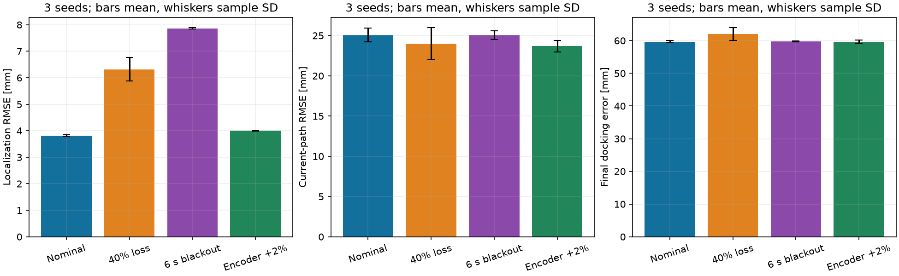

# Visual waypoint navigation and ArUco docking

41014 Sensors and Control in Mechatronics Systems  
Group 19 — Enqian Tang, 25646922  
Track A · approved individual group

This project connects sensing, state estimation and feedback control in a MuJoCo navigation task. A differential-drive robot visits three waypoints, avoids an obstacle and returns to an ArUco-marked charging station. The robot is a simplified TurtleBot3-style model with wheel encoders, a downward camera, a forward camera and a simulated 2D LiDAR.

Wheel odometry provides frequent motion estimates, but it accumulates error when the wheels slip. I use an EKF to correct that prediction with camera pose measurements from a known marker map. LiDAR supplies the obstacle map for A*, and a local LQR tracker turns the planned path into velocity commands. A separate encoder-based wheel-speed loop applies the motor torques. The controller receives estimated position and heading; simulator pose is reserved for sensor generation, evaluation and display.

The route uses three waypoints: (1,0) m on the far side of the obstacle, (0,1) m across the room, then (0,0) m at the start, before visual docking. This keeps obstacle avoidance, a change of travel direction and a return leg before docking. The brief does not prescribe four waypoints. The repeated experiments cover nominal operation, random camera-observation loss, a six-second blackout and encoder scale error. The current measurements are reported in the results section; the previous four-waypoint results are not mixed into this version.


The three-waypoint route completes in 58.29 s on average in nominal trials, including the one-second charging demonstration. Mean localization RMSE is 3.81 mm and mean final docking error is 59.65 mm. These measure estimator accuracy and final stopping position respectively.

## Reading the project

[Design](docs/model-and-design.md) explains the model, coordinate frames, camera geometry, EKF and controller. [Results](docs/results.md) contains the repeated trials, uncertainty plots and measurement-noise sensitivity. [Discussion](docs/discussion.md) connects those results to the design choices and remaining weaknesses.



## Install and reproduce

Windows 11 with an OpenGL-capable graphics driver. Tested with Python 3.11.9, MuJoCo 3.15.0, NumPy 2.4.6 and OpenCV contrib 4.11.0.86. A fresh Python 3.12.14 environment was also installed from the submitted lockfile and completed the nominal mission; six regression checks pass on the current version. Rendering is still needed in headless mode; a GPU/display context is required. Linux/macOS installation and rendering have not been verified.

From the repository root in PowerShell:

Extract the complete project folder before running it. Opening a Python file directly inside a ZIP creates a temporary location and may select a different Python installation. In VS Code, open the project folder and select its `.venv` interpreter. The included launch configuration uses that environment for debugging.

```powershell
py -3.11 -m venv .venv
.\.venv\Scripts\python.exe -m pip install -r requirements-lock.txt
.\.venv\Scripts\python.exe -m unittest discover -s tests -v
.\.venv\Scripts\python.exe tools\calibrate_validate.py
.\.venv\Scripts\python.exe run_sim.py --headless --seed 7 --output results/reproduced_nominal --video
```

Use `py -3.12` if that is your installed version. GUI demonstration:

```powershell
.\.venv\Scripts\python.exe run_sim.py --camera-preview
```

After installing the environment, `START_DEMO.bat` launches the same GUI demonstration by double-click. In VS Code, select **Track A simulation** in Run and Debug and press F5.

Space pauses; R resets; Esc closes the MuJoCo window. After a one-second charging demonstration the GUI holds the completed view until it is closed. Close the viewer to save GUI logs. Headless mode stops after one second of charging or at the chosen time budget; exit 1 means the run did not finish charging or recorded contact. Analysis applies the stricter independent docking-error criteria described in the design document.

Repeat the complete declared matrix and regenerate figures:

```powershell
.\.venv\Scripts\python.exe tools\run_experiments.py --workers 2
.\.venv\Scripts\python.exe run_sim.py --headless --seed 7 --r-scale .1 --output results/r01_s7
.\.venv\Scripts\python.exe run_sim.py --headless --seed 7 --r-scale 10 --output results/r10_s7
.\.venv\Scripts\python.exe -m pip install -r requirements-analysis.txt
.\.venv\Scripts\python.exe tools\analyze_results.py
.\.venv\Scripts\python.exe tools\build_page.py
```

The complete-vision-loss trial intentionally returns 1 and is preserved as a failure case. Do not delete or relabel it as successful. Rerunning overwrites same-named results; copy the results directory first if you want to preserve this submission's data. PNG plots and the static project page can be viewed without installing analysis packages.

## Files

The runtime is in `run_sim.py`. Its classes separate sensor generation, estimation, planning, control, evaluation and recording. `track_a_scene.xml` defines the physical scene and camera mounts; `landmark_map.json` supplies the known marker corners; `assets/` contains the marker textures. The scripts in `tools/` run the calibration checks, repeated trials and analysis. `tests/` contains the numerical and feedback-boundary checks. Raw measurements and the parameters used for each trial are kept in `results/`.

## Project notes

This is an individual project. My responsibility covers the model, sensing, estimation, control, experiments and demonstration. The [development notes](docs/contributions.md) identify the starting files and route revision. The simulation is not a manufacturer-validated robot model, and no hardware result is reported.

Code is available in the [GitHub repository](https://github.com/Tommy-662/41014-track-a-group19). Watch the [five-minute demonstration](https://youtu.be/7SyLCQ77BmU) for the nominal run, camera-observation dropout trial and quantitative results.
