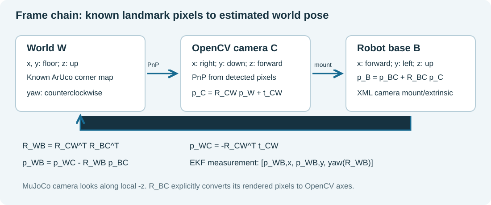

# Model, sensing, estimation and control

## Scope and architecture

The route has three waypoints: (1,0) m beyond the obstacle, (0,1) m across the room, and (0,0) m at the start. After the return, the robot approaches the charging station and shows one second of simulated charging. This gives an outward detour, a cross-room leg and a return for estimated-state tracking.

Track A, simulation only. The MJCF is a simplified TurtleBot3-style differential-drive robot, not a manufacturer-validated TurtleBot3 dynamic model. Radius 0.05 m and track 0.21 m come from this submitted scene. A caster, wheel-ground contact and motor torque are simulated by MuJoCo. The task is three position waypoints, obstacle detour, and visual alignment with a virtual charging connector. There is no physical electrical contact sensor and no hardware result.

```
world W --known landmark corners--> rendered onboard RGB pixels
                    |                    |
wheel joint increments -> odometry -> EKF <- ArUco / PnP / rigid transforms
                                      |
LiDAR ranges -> grid + A* <------- estimated world pose
                     |                |
                     +--> local target + LQR / turn mode -> wheel targets
noisy encoder wheel speed -----------------> torque inner loop -> physics
front ArUco relative station -> estimated dock position -> docking supervisor

physics truth ----> Evaluator / CSV / plots / video ONLY
```

SensorSimulator accesses MuJoCo geometry to synthesise sensor measurements. This is the simulator sensor boundary, not a pose observation passed directly to the controller. The controller receives only the estimated planar pose and a target; the torque loop receives noisy quantised encoder increments. Evaluation code in Demo.tick/close reads truth to log metrics after commands have already been selected, and never writes that truth into estimation, planning or control. The overhead camera is presentation only.

## Coordinates and transforms



World W: x and y lie in the floor, z is up; SI metres, seconds, radians. Base B: x forward, y left, z up; yaw is counterclockwise about z. The base origin is the chassis freejoint origin. Wheel centres are 0.045 m forward of that origin, so treating its motion as an ideal axle-centre unicycle is an approximation. Camera C uses OpenCV x right, y down, z forward; MuJoCo camera optical direction is its negative local z, requiring the explicit conversion below.

R_BC maps OpenCV camera vectors into base coordinates; p_BC is the camera optical centre in base coordinates:

| Camera | p_BC [m] | R_BC | image / FOV |
|---|---|---|---|
| downward | [0.14,0,0.60] | diag(1,-1,-1) | 480x480, vertical 90 deg |
| forward | [-0.04,0,0.22] | [[0,0,1],[-1,0,0],[0,-1,0]] | 480x480, vertical 65 deg |

PnP returns p_C = R_CW p_W + t_CW. Then R_WB = R_CW^T R_BC^T; p_WC = -R_CW^T t_CW; p_WB = p_WC - R_WB p_BC. Yaw = atan2(R_WB[1,0], R_WB[0,0]). A station point is measured as p_BS = p_BC + R_BC (R_CW p_WS + t_CW), then mapped into W using the EKF pose. Thus docking position originates in pixels and EKF pose. The station's known orientation sets desired heading pi; its true scene location is used only for evaluation.

Marker dictionary DICT_4X4_50. Floor marker black-square side = 0.14*200/270 = 0.103704 m; station black-square side = 0.30*200/270 = 0.222222 m. The image's white border must not be counted as black-square size. Ordered world corners are in landmark_map.json. This is localization against a known map, not SLAM.

## Motion model and local analysis

State x=[p_x,p_y,psi]^T, velocity input u=[v,omega]^T. Continuous model:

    p_x_dot = v cos(psi), p_y_dot = v sin(psi), psi_dot = omega.
    v = r(w_R+w_L)/2, omega = r(w_R-w_L)/b.

At each 0.02 s controller step (physics 0.002 s, ten substeps), encoders supply wheel travel d_L,d_R. With d_s=(d_L+d_R)/2, d_a=(d_R-d_L)/b, a=psi+d_a/2:

    f(x,d) = [p_x+d_s cos(a), p_y+d_s sin(a), wrap(psi+d_a)].
    F = [[1,0,-d_s sin(a)],[0,1,d_s cos(a)],[0,0,1]].

No-slip planar kinematics, fixed wheel geometry, negligible roll/pitch in estimator, and a known initial pose are assumptions, not universal truths. Physics includes slip that this model omits.

The tracking error is reference minus robot expressed in a locally fixed reference frame: [along,cross,heading]. At reference speed 0.12 m/s and sample T=0.02 s:

    A = [[1,0,0],[0,1,0.12*T],[0,0,1]]
    B = [[-T,0],[0,0],[0,-T]].

The controllability matrix [B,AB,A^2 B] has rank 3 for nonzero reference speed. At zero speed the lateral row decouples and rank is 2; a stationary linearization cannot instantaneously correct lateral error. Turn-in-place and waypoint mode switching address large heading errors, outside the LQR's local assumptions. Stability of A-BK establishes only local unsaturated linear stability; it is not a proof for A*, mode switches, slip, saturation or the entire mission.

Camera pose observation z=x+noise has H=I_3, giving local observability rank 3 wherever PnP is valid. Encoders alone give relative increments and cannot identify arbitrary initial global translation/yaw. During camera loss, EKF propagates with increasing covariance; restoring a valid observation restores absolute correction. LiDAR builds an obstacle map but is not fused as a localization observation in this version. Camera pose observability depends on known nondegenerate marker geometry and successful association, not solely on writing H=I.

## Camera calibration and sensor noise

Analytic intrinsic calibration: f_x=f_y=240/tan(FOV_y/2), c_x=c_y=239.5 pixels. Thus downward f=240 px; forward f approximately 376.7245 px. Lens distortion is zero by renderer construction. Extrinsics come from the XML mounts and OpenCV-to-MuJoCo frame conversion. This is not a fitted real-camera calibration. `tools/calibrate_validate.py` independently samples 28 held-out pose/heading combinations and reports detection availability, base pose errors, station-relative errors and reprojection residuals. All errors use truth only in this validation harness. The exact generated evidence is in `results/calibration_validation.json`.

Noise: image Gaussian sigma=1 intensity unit per RGB channel, clipping to uint8; encoder quantisation 4096 counts/revolution plus travel noise sigma=15 micrometres per sample; LiDAR 120 rays over 360 degrees, max range 3 m, sigma=3 mm, sampled 5 Hz. Sensor noise uses a seeded generator. Range clipping and quantisation mean these distributions are not perfectly Gaussian.

Multi-marker PnP uses RANSAC: 100 iterations, 2.5 px threshold, at least eight inlier corners, followed by iterative refinement. Single marker uses planar IPPE. Poses with reprojection RMS >2 px or base height outside (0.02,0.18) m are discarded. Residual is sqrt(mean of squared pixel-coordinate errors), not RMS Euclidean 2D corner distance. The reported mean is over accepted poses; it omits failed detections. Detection quality, geometry and pose error are separate metrics. Long-range single-marker range is less reliable than nearby multi-marker localization; calibration results quantify this limitation.

## State estimation

Initial mean [0,0,0], P0=diag(0.03,0.03,0.08)^2. Prediction Q=diag(2e-6,2e-6,8e-6) per 50 Hz step, in m^2,m^2,rad^2. Q is a conservative additive model-error allowance for slip/kinematic mismatch, not a fitted encoder covariance. Position observation R=diag(0.007,0.007,0.025)^2. These standard deviations exceed held-out static image errors to allow dynamic motion/geometry effects. They are chosen engineering allowances; they are not maximum-likelihood estimates from hardware.

Innovation uses wrapped yaw. S=P+R, squared Mahalanobis gate=25; accepted update K=P S^-1. Joseph covariance update (I-K)P(I-K)^T+KRK^T maintains numerical symmetry/positive covariance. This gate is a fixed design value, not the usual 95% chi-square threshold. Only valid camera poses reset camera age; a rejected valid pose currently resets age too, a limitation under sustained outliers.

CSV stores estimated position/yaw and 1-sigma values. Evaluation uses the exact same pre-physics time for truth and estimate. Position RMSE=sqrt(mean((xhat-x)^2+(yhat-y)^2)); yaw RMSE uses wrapped angular error. Raw odometry is logged as an estimator comparison using the same wheel increments and no camera correction. NEES=e^T P^-1 e is reported over correlated trajectory samples; its mean is diagnostic, not a formal independent-sample consistency test. Three-dimensional ideal Gaussian NEES has expected value 3, but nonlinearity, gating, correlation and model mismatch matter.

## Path planning and feedback control

Discrete LQR solves the algebraic Riccati equation iteratively to 1e-9 change, maximum 5000 iterations. Cost Q_LQR=diag(4,14,4), R_LQR=diag(2,1.5). These are cost weights, unrelated to EKF noise Q/R. Cross-track weight 14 prioritises lateral path adherence; input weights limit aggressive corrections. Run `tools/analyze_results.py` for the actual gain, poles, rank and numerical residual.

u=[0.12,0]-K e (slow docking feedforward 0.06). Limits: v 0..0.16 m/s (docking 0..0.10), omega +/-1 rad/s, distance-dependent speed cap 0.8*distance, angular cosine scaling. For point bearing error >0.75 rad, turn-in-place at clip(2.2*error,+/-1). Wheels are limited +/-6 rad/s. Torque command = clip(0.15*(target wheel velocity - measured encoder wheel velocity),+/-0.20) N m, held over ten physics steps. No qvel feedback is used. Saturation and hybrid logic mean the implemented tracker is not a pure unconstrained LQR.

LiDAR grid 0.07 m, dimensions 35x33, origin [-0.7,-0.6]. Hit/free evidence is accumulated with bounded scores; cells with score >=2 occupied. A* uses 8-neighbour connectivity, no diagonal corner cutting. Inflation 0.245 m (0.17 m docking), replan every 0.5 s, lookahead 0.18 m. Unknown cells are not conservatively blocked: this is not a certified exploration planner. A forward ray cone +/-0.35 rad brakes translation below 0.24 m. Sensor origin and chassis clearance differ: minimum LiDAR range is not minimum body-surface clearance.

Waypoints [1,0],[0,1],[0,0] m use 0.075 m estimated arrival tolerance and 0.6 s hold. Stop errors in results are actual truth distance at the estimated arrival event. Dock goal = measured world station position+[0.20,0]; translation tolerance 0.06 m (alignment retains mode to 0.08 m); heading entry <0.07 rad. Charge supervisor requires position <=0.09 m, heading <=0.12 rad and station freshness <=2 s. Entry requires pose age <0.4 s and station age <0.6 s. A BLOCKED docking plan with a station observation older than 2 s clears that target and reacquires the marker before trying again. The relaxed retention threshold explains final heading/position being larger than entry limits. The result is alignment with a virtual connector, rather than a physical contact-docking test.

Virtual electrical model: 2.2 Ah, OCV=10.8+1.8*SOC, battery resistance 0.25 ohm, external equivalent 0.75 ohm, first-order RC transient 20 s, current capped 1 A, electrical time accelerated 60x. SOC can end below its initial value despite charging because the preceding mission consumes energy. One second of positive charging current is demonstrated; physical energy delivery is not.

## Evaluation method

`tools/run_experiments.py` declares seeds 7,11,23 under nominal, 40% independent camera-pose dropout, 20..26 s complete vision blackout, and +2% encoder travel scale. The rendering still occurs during dropout; this tests missing observations, not realistic occlusion/illumination image degradation. Encoder scale tests wheel-distance calibration mismatch, not an externally applied force. A separate 100% vision-loss trial demonstrates a boundary failure. Small seeded trials in one scene do not establish real-world reliability. The complete-loss run is retained alongside the successful trials to show where this approach stops working.

Tracking RMSE is perpendicular distance from evaluation truth to the current A* polyline during tracking modes. It is spatial path following, not error to a timed trajectory; replanning changes the reference and can make it optimistic. Torque-squared integral (N^2 m^2 s) is a control-effort proxy, not energy. Contact count is contact samples, not unique collision events. Success requires all three waypoints, CHARGING with >=1 s positive charge, zero obstacle/wall/charger contacts, actual docking error <=0.09 m and heading <=0.12 rad. Simulator failure exits and nonzero statuses remain in stdout.
