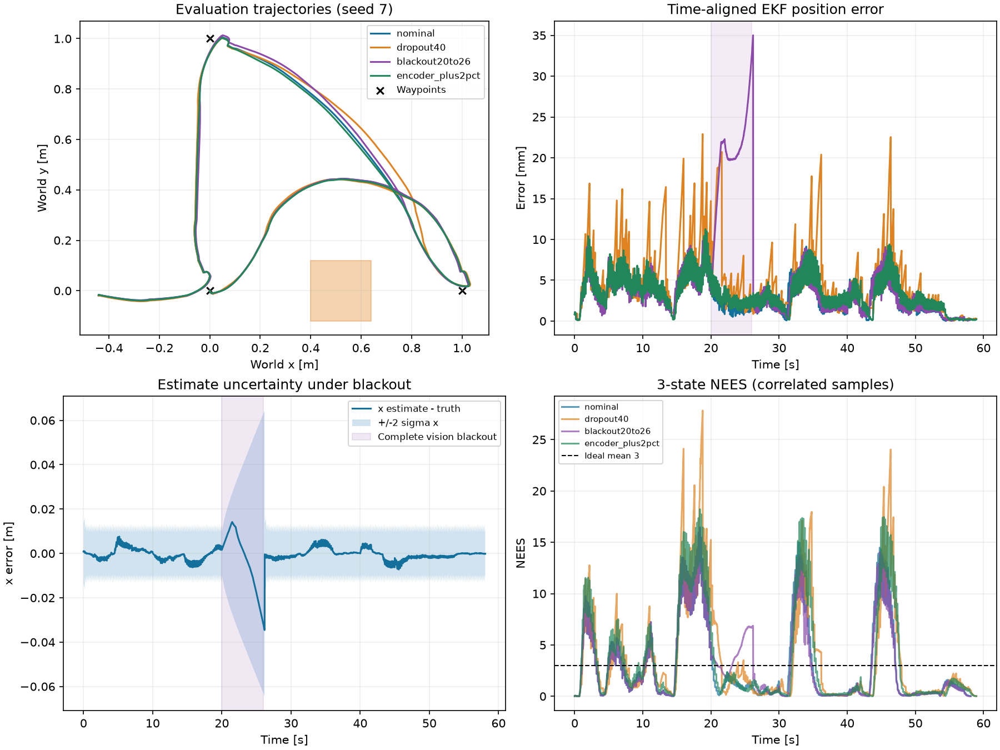
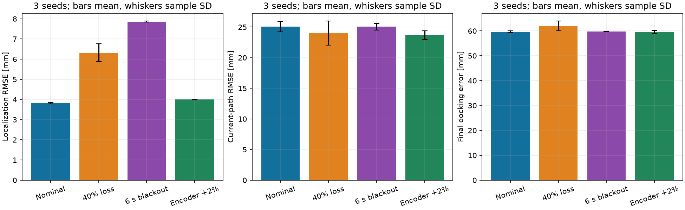

# Repeated-trial results

Fresh runs from the submitted source; 3 seeds per condition. Mean +/- sample SD. Completion time includes a one-second charging demonstration.

| Condition | success | localization RMSE mm | path RMSE mm | dock error mm | time s | mean NEES |
|---|---:|---:|---:|---:|---:|---:|
| nominal | 3/3 | 3.81 +/- 0.03 | 25.08 +/- 0.85 | 59.65 +/- 0.34 | 58.29 +/- 0.12 | 2.92 +/- 0.02 |
| dropout40 | 3/3 | 6.32 +/- 0.44 | 24.00 +/- 1.97 | 62.02 +/- 1.91 | 58.61 +/- 0.32 | 3.77 +/- 0.09 |
| blackout20to26 | 3/3 | 7.86 +/- 0.02 | 25.07 +/- 0.55 | 59.78 +/- 0.11 | 58.23 +/- 0.12 | 3.16 +/- 0.04 |
| encoder_plus2pct | 3/3 | 4.00 +/- 0.01 | 23.69 +/- 0.72 | 59.61 +/- 0.51 | 59.01 +/- 0.09 | 3.61 +/- 0.06 |

Each 3/3 rate has a 95% Wilson interval approximately [0.44,1.00]; trials are few and share one scene. Zero contact samples were observed in successful trials. Path RMSE uses the changing planned polyline, so it is not a timed trajectory metric. Localization RMSE is not final docking error.

## Trial detail

| Condition | seed | odom RMSE m | yaw RMSE rad | dock yaw rad | torque effort N^2 m^2 s |
|---|---:|---:|---:|---:|---:|
| nominal | 7 | 0.4195 | 0.0240 | 0.0821 | 1.1716 |
| nominal | 11 | 0.4230 | 0.0238 | 0.0817 | 1.1803 |
| nominal | 23 | 0.4235 | 0.0239 | 0.0811 | 1.1816 |
| dropout40 | 7 | 0.4326 | 0.0335 | 0.0841 | 1.1989 |
| dropout40 | 11 | 0.4201 | 0.0309 | 0.0822 | 1.2038 |
| dropout40 | 23 | 0.4388 | 0.0323 | 0.0841 | 1.1797 |
| blackout20to26 | 7 | 0.4137 | 0.0306 | 0.0809 | 1.1722 |
| blackout20to26 | 11 | 0.4180 | 0.0308 | 0.0804 | 1.1730 |
| blackout20to26 | 23 | 0.4197 | 0.0313 | 0.0799 | 1.1827 |
| encoder_plus2pct | 7 | 0.5115 | 0.0266 | 0.0824 | 1.1744 |
| encoder_plus2pct | 11 | 0.5148 | 0.0268 | 0.0815 | 1.1764 |
| encoder_plus2pct | 23 | 0.5142 | 0.0271 | 0.0815 | 1.1875 |

## Sensor validation

28 held-out poses: 28/28 base-pose detections; 8/28 station-relative detections. Base position RMSE 0.611 mm; yaw RMSE 0.000529 rad. Station-relative RMSE over detected cases 29.15 mm; max 78.60 mm. The three near-dock front-facing samples have station-relative RMSE 2.22 mm. Long-range oblique planar PnP depth is less constrained despite low pixel residual. Missing station detections are expected when facing away and are retained in raw results.

## Failure boundary

100% camera observation loss, seed 7, 50 s evaluation budget: stage SEARCH DOCK, estimated waypoint counter 3/3 (not independently verified true arrivals), position RMSE 0.274 m, 0 contact samples. The run is a failed mission and is not included in the 12-trial success denominator. Without camera measurements, no visual station estimate is available, so the visual-docking requirement cannot be completed; odometry also accumulates slip error. This run does not claim a 240 s timeout test.

## EKF measurement-noise sensitivity (one seed, exploratory)

| R multiplier | localization RMSE mm | mean NEES | path RMSE mm | torque effort | success |
|---|---:|---:|---:|---:|---|
| 0.1 | 1.745 | 1.222 | 25.069 | 1.182 | True |
| 1.0 | 3.777 | 2.941 | 24.110 | 1.172 | True |
| 10.0 | 11.831 | 5.964 | 25.814 | 1.244 | True |

The table compares measurement weighting, actual error and reported uncertainty on one seed. It is a sensitivity probe, not a statistically established optimum. The common baseline is retained across the repeated trials. Smaller R gives camera observations more weight; the resulting NEES depends on both actual error and posterior covariance.

For the interpretation of these trials and the limitations of the metrics, see [Discussion](discussion.md).
